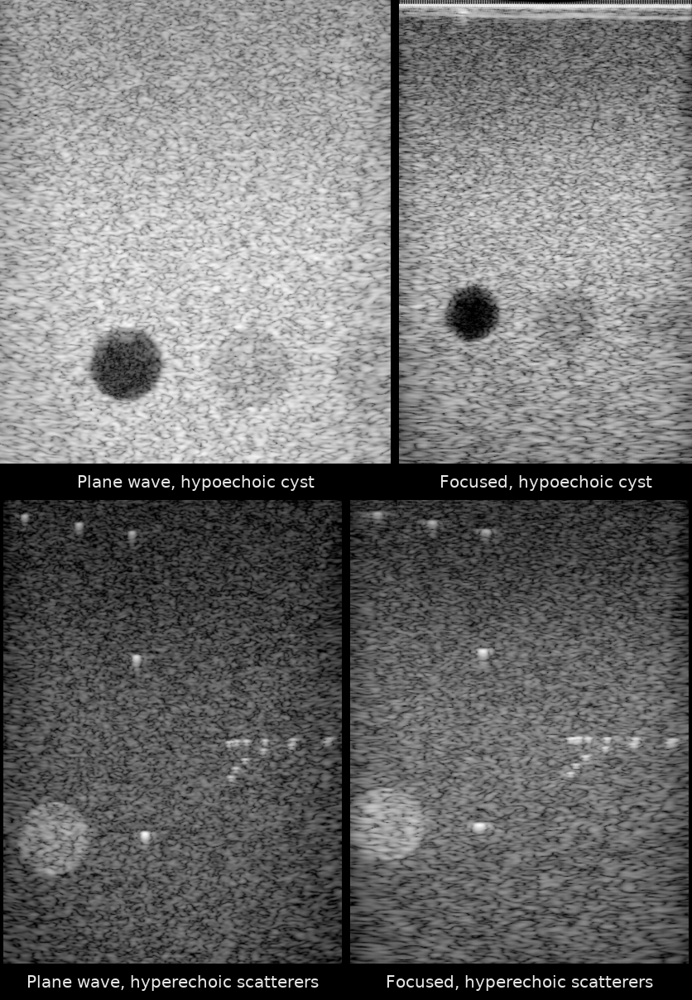

# UltraSound ToolBox (USTB) Channel Capture Data, PULSE Lab, Johns Hopkins University

*First frames of all four acquisitions, reconstructed from the raw channel data with `reconstruct.py`. Top: [`alpinion_phantom/JHU_Alpinion_L3-8_CPWC_hypoechoic`](https://huggingface.co/datasets/nvidia/Open-H-RF/blob/main/jhu-pulselab/alpinion_phantom/JHU_Alpinion_L3-8_CPWC_hypoechoic.hdf5), [`alpinion_phantom/JHU_Alpinion_L3-8_FI_hypoechoic`](https://huggingface.co/datasets/nvidia/Open-H-RF/blob/main/jhu-pulselab/alpinion_phantom/JHU_Alpinion_L3-8_FI_hypoechoic.hdf5). Bottom: [`alpinion_phantom/JHU_Alpinion_L3-8_CPWC_hyperechoic_scatterers`](https://huggingface.co/datasets/nvidia/Open-H-RF/blob/main/jhu-pulselab/alpinion_phantom/JHU_Alpinion_L3-8_CPWC_hyperechoic_scatterers.hdf5), [`alpinion_phantom/JHU_Alpinion_L3-8_FI_hyperechoic_scatterers`](https://huggingface.co/datasets/nvidia/Open-H-RF/blob/main/jhu-pulselab/alpinion_phantom/JHU_Alpinion_L3-8_FI_hyperechoic_scatterers.hdf5). Panels are scaled to a common height per row, not to a common physical scale.*

## Dataset Description

Contributed by the **Photoacoustic & Ultrasonic Systems Engineering (PULSE) Lab, Johns Hopkins University (JHU)** to the [Open-H-RF](https://github.com/open-h/Open-H-RF) initiative. The data is owned by JHU. All data is pre-beamformed (raw channel-capture) ultrasound stored in the **zea** HDF5 format and released under **CC BY 4.0**.

These acquisitions are part of the **UltraSound ToolBox (USTB) Channel Capture Collection**; the rest of that collection is in [`oslo/`](../oslo/README.md).

4 acquisitions packaged into a single application sub-dataset. The sub-dataset folder contains its zea `.hdf5` files, a Hugging Face–style `README.md` data card, and reference B-mode images. The **`reconstruct.py`, `parameters.yaml` and `pipeline*.yaml` files live once at the root of this collection** (`jhu-pulselab/`); the sub-dataset folder also holds a `pipeline.yaml` for its example acquisition. The data card declares `license: cc-by-4.0` in its YAML frontmatter.

| Folder | Sub-dataset | Tier | RFP task | Acq. |
|---|---|---|---|---|
| [`alpinion_phantom/`](alpinion_phantom/README.md) | Phantom (Alpinion L3-8) | phantom | 6.1 Generalized Reconstruction | 4 |

Total: **4 acquisitions**, 0.47 GB of stored HDF5 data.

## Dataset Contributor(s)

- Muyinatu A. Lediju Bell <mledijubell@jhu.edu> (primary contact)
- Ole Marius Hoel Rindal <omrindal@ifi.uio.no>
- Photoacoustic & Ultrasonic Systems Engineering (PULSE) Lab, Johns Hopkins University

## Dataset Creation Date

06/23/2026 (packaging date; the original acquisitions were made at the PULSE Lab, Johns Hopkins University, in 2017).

## License / Terms of Use

[Creative Commons Attribution 4.0 International (CC BY 4.0)](https://creativecommons.org/licenses/by/4.0/legalcode.en). Retain attribution and identify modifications when reusing the data.

## Processing the Dataset

Every acquisition is reconstructable from the file alone — all acquisition parameters live in the zea `/scan` and `/probe` groups. The acquisitions can be processed with the `reconstruct.py` [script](https://github.com/open-h/Open-H-RF/blob/main/datasets/jhu-pulselab/reconstruct.py), as provided in the [Open-H-RF GitHub repository](https://github.com/open-h/Open-H-RF), together with the `pipeline*.yaml` and `parameters.yaml` definitions in this folder and the [zea library](https://github.com/tue-bmd/zea). The script streams the data from the Hugging Face Hub: set `PATHS` to the acquisition to reconstruct and `REFOCUS = True` to also emit the REFoCUS variant (the script and pipelines are the same as the USTB collection's; see its card's [Reconstruction Details](../oslo/README.md#reconstruction-details)). The sub-dataset folder also holds a `pipeline.yaml` for its example acquisition, so it can be rendered with a single `zea process` command (see the [sub-dataset card](alpinion_phantom/README.md)).

## Dataset Format

[zea v0.1.6](https://github.com/tue-bmd/zea)

## Dataset Quantification

**Current Open-H-RF release:** 4 HDF5 files; 466.42 MB (466,419,712 bytes) stored; root `zea_version` **0.1.6**. Sizes include all HDF5 contents and use decimal units (MB = 10^6 bytes, GB = 10^9 bytes, TB = 10^12 bytes), not decoded-array memory or original-source download sizes.

## Citation

Please credit the PULSE Lab, Johns Hopkins University, as the owner of this data, and cite the UltraSound ToolBox (USTB) proceedings paper:

A. Rodriguez-Molares, O. M. H. Rindal, O. Bernard, A. Nair, M. A. Lediju Bell, H. Liebgott, A. Austeng and L. Løvstakken, "The UltraSound ToolBox," in *2017 IEEE International Ultrasonics Symposium (IUS)*, 2017, pp. 1–4. doi:[10.1109/ULTSYM.2017.8092389](https://doi.org/10.1109/ULTSYM.2017.8092389)
